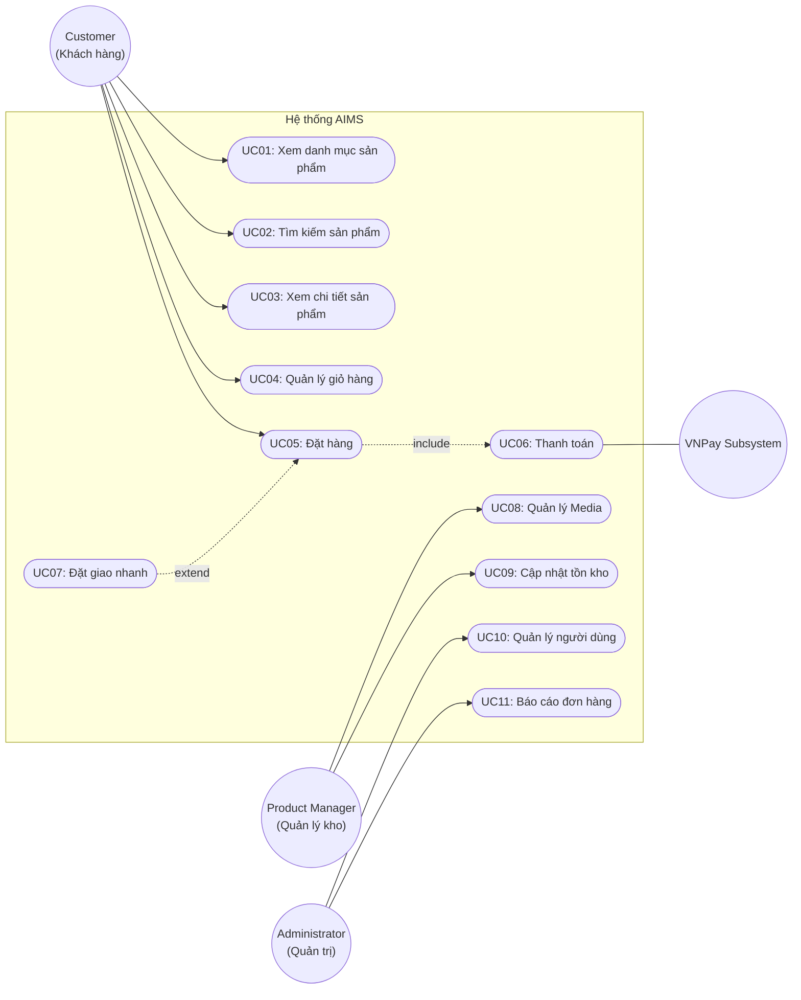

# Tài liệu Use Case hệ thống AIMS

UC01: Xem danh mục sản phẩm (View Media List)
Actor chính: Customer

Mô tả: Cho phép người dùng duyệt danh sách các mặt hàng Media (Book, CD, DVD) đang bán trên hệ thống.

Tiền điều kiện: Ứng dụng đã khởi chạy và kết nối được với cơ sở dữ liệu.

Hậu điều kiện: Danh sách sản phẩm được hiển thị trực quan lên màn hình chính.

Luồng sự kiện chính (Basic Flow):

Người dùng mở màn hình chính của ứng dụng (HomeScreen).

Hệ thống truy vấn danh sách các sản phẩm đang bán kèm số lượng tồn kho.

Hệ thống hiển thị danh sách sản phẩm theo dạng lưới (Grid View): Ảnh đại diện, Tiêu đề, Loại sản phẩm, Đơn giá và nút thêm giỏ hàng.

Người dùng cuộn hoặc chuyển trang để duyệt thêm sản phẩm.

Luồng ngoại lệ (Exception Flow):

2a. Cơ sở dữ liệu trống hoặc lỗi kết nối: Hệ thống thông báo lỗi "Không thể kết nối đến máy chủ, vui lòng thử lại sau" và cung cấp nút "Tải lại trang".

UC02: Tìm kiếm sản phẩm (Search Media)
Actor chính: Customer

Mô tả: Lọc và tìm kiếm các mặt hàng Media theo từ khóa tiêu đề sản phẩm.

Tiền điều kiện: Người dùng đang ở màn hình danh sách sản phẩm.

Hậu điều kiện: Danh sách các sản phẩm khớp với tiêu đề tìm kiếm được hiển thị.

Luồng sự kiện chính (Basic Flow):

Người dùng nhập từ khóa tìm kiếm vào thanh công cụ Search.

Người dùng nhấn nút "Tìm kiếm" (hoặc nhấn Enter).

Hệ thống quét qua danh sách sản phẩm và lọc ra các mục có tiêu đề chứa chuỗi từ khóa (không phân biệt hoa/thường).

Hệ thống cập nhật lại giao diện hiển thị danh sách các kết quả tìm thấy.

Luồng sự kiện thay thế (Alternative Flows):

1a. Từ khóa rỗng: Người dùng xóa trắng ô tìm kiếm và bấm Enter, hệ thống hiển thị lại toàn bộ sản phẩm mặc định.

3a. Không tìm thấy kết quả: Nếu không có sản phẩm nào khớp, hệ thống hiển thị thông báo "Không tìm thấy sản phẩm phù hợp với từ khóa của bạn".
